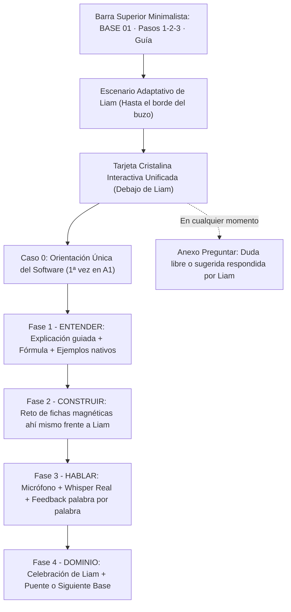

# Auditoría Cruda y Blueprint Interactivo: Clase A1 (Mobile-First → PC)

> [!IMPORTANT]
> **Diagnóstico directo y sin humo**: Hoy la clase tiene una base pedagógica muy buena en contenido (32 bases por nivel con contraste español vs. inglés), pero sufre **3 rupturas críticas** que rompen la magia en móvil y sabotean la evaluación real de voz. Tu idea de **unificar toda la experiencia móvil en una sola vista frente a Liam (sin mandarlo a una pizarra aparte)** resuelve de raíz la desconexión visual y emocional.

---

## 1. La Verdad Cruda sobre el Reto de Voz (`3. Habla`) Hoy

Revisando línea por línea [`usePathwayStageSession.ts`](file:///c:/Users/user/Music/celaest-english-front/src/features/pathway/hooks/usePathwayStageSession.ts#L210-L283), [`audioCaptureService.ts`](file:///c:/Users/user/Music/celaest-english-front/src/features/conversation/services/audioCaptureService.ts#L910-L1057) y [`PathwayPronunciationEngine.ts`](file:///c:/Users/user/Music/celaest-english-front/src/features/pathway/services/PathwayPronunciationEngine.ts#L96-L224), esto es **exactamente** lo que sí hay y lo que está fallando hoy:

### ¿Qué SÍ evalúa de verdad hoy?
1. **Motor de alineación léxico-fonética real** en [`PathwayPronunciationEngine.ts`](file:///c:/Users/user/Music/celaest-english-front/src/features/pathway/services/PathwayPronunciationEngine.ts#L96-L224):
   - No regala el aprobado: exige `overallScore >= 80%`, `completenessScore >= 80%` y **cero palabras omitidas** (`omittedWords.length === 0`).
   - Compara palabra por palabra con distancia Levenshtein (`>= 0.88` correcta en verde, `0.65–0.87` casi exacta en ámbar, `0.40–0.64` mal pronunciada en rojo, `< 0.40` omitida tachada).
   - Detecta trampas clásicas del hispanohablante (`es-` antes de `s`, confusión `b/v`, `d/th` en `the/this`) y genera feedback hablado específico diciendo qué palabra escuchó (`heardAs`) y cómo corregirla.
2. **Persistencia real en PostgreSQL + Caché Local** en [`ApiPathwayRepository.ts`](file:///c:/Users/user/Music/celaest-english-front/src/infrastructure/repositories/ApiPathwayRepository.ts#L292-L389):
   - Al aprobar, envía `POST /api/v1/pathway/nodes/:id/evaluate` con los puntajes y errores detectados, desbloquea la siguiente base y actualiza el progreso.

### ¿Qué está ROTO o incompleto hoy en la evaluación de voz? (Crítico)

> [!CAUTION]
> **Bug #1 — Se descarta el audio grabado sin pasarlo por Whisper (`transcribeAudio`)**: En [`usePathwayStageSession.ts`](file:///c:/Users/user/Music/celaest-english-front/src/features/pathway/hooks/usePathwayStageSession.ts#L215-L228), al detener el micrófono se llama a `stopAndGetAudio()`, **se revoca inmediatamente el `audioUrl` y jamás se envía `res.pendingTailBlob` ni `res.audioBlob` a `AudioCaptureService.transcribeAudio()`** (a diferencia del módulo de Entrevistas que sí usa Groq Whisper Large V3 Turbo / Backend).
> - **Consecuencia en Móvil**: `MobileLiveStreamEngine` corta en bloques de ~2.5s. Como una frase A1 (*"I learn English every day"*) dura ~1.8s, toda la frase queda en `pendingTailBlob` / `audioBlob` y `confirmedMobileTranscript` llega vacío o cortado a la mitad. El alumno pronuncia perfecto y el sistema le dice falsamente *"No te escuché hablar"* o *"Te comiste palabras"*.
> - **Consecuencia en Safari / Brave / iOS**: `webkitSpeechRecognition` no emite o falla y, al no invocar Whisper sobre el `audioBlob`, nunca evalúa nada.
> - **Bug adicional en línea 225**: `AudioCaptureService.getLatestTranscript()` siempre devuelve `""` porque `stopAndGetAudio()` limpia `this.latestTranscript = ""` antes de retornar en [`audioCaptureService.ts`](file:///c:/Users/user/Music/celaest-english-front/src/features/conversation/services/audioCaptureService.ts#L943).

- **Limitación #2 — Evaluación sobre texto transcrito sin confianza acústica (`avgLogprob`)**:
  - En Chrome de escritorio, `webkitSpeechRecognition` "autocorrige" palabras mal pronunciadas si adivina la frase. Si en cambio pasamos siempre el `audioBlob` grabado por **Whisper (`verbose_json`, `temperature: 0`, prompt verbatim ESL)**, obtenemos lo que el usuario **realmente articuló** más métricas reales (`noSpeechProb`, `avgLogprob`) para una evaluación justa, rápida (~200–350ms) e idéntica en móvil y PC.
- **Limitación #3 — Botón de escape demasiado regalado**:
  - En [`PathwayVoiceUnlockStep.tsx`](file:///c:/Users/user/Music/celaest-english-front/src/features/pathway/components/stages/PathwayVoiceUnlockStep.tsx#L51-L53) aparece siempre visible *"Completar paso sin micrófono →"* al lado del botón principal, tentando al alumno a saltarse el habla desde el primer intento.

---

## 2. Otras 3 Rupturas Actuales en el Flujo de Clase A1

1. **Móvil partido en dos mundos desconectados** ([`PathwayStudioView.tsx`](file:///c:/Users/user/Music/celaest-english-front/src/features/pathway/components/PathwayStudioView.tsx#L30-L71)):
   - En móvil existe `mobileMode: "lecture" | "practice"`. Al pasar a `BUILD` o `SPEAK`, **Liam desaparece por completo (`hidden`)**. Cuando armas bloques o "le hablas al Profesor", Liam ni siquiera está en pantalla; no ves su radar al escucharte ni su cara feliz al aprobar.
2. **Cabecera y Guía inaccesibles en Móvil mientras estás con Liam** ([`PathwayLessonHeader.tsx`](file:///c:/Users/user/Music/celaest-english-front/src/features/pathway/components/PathwayLessonHeader.tsx#L24-L61)):
   - En Base 01 Liam te dice: *"Arriba tienes la Guía de Estudio con los 14 Bloques y el Alfabeto Fonético"*, pero en móvil esa cabecera está oculta dentro de la columna `practice`. Tampoco puedes cambiar de Base (`Ruta 0/32`) ni ver en qué paso (`1 · 2 · 3`) vas sin salirte de Liam.
3. **Guion de bienvenida con referencias espaciales solo de PC** ([`PathwayLectureEngine.ts`](file:///c:/Users/user/Music/celaest-english-front/src/features/pathway/services/PathwayLectureEngine.ts#L17-L19)):
   - El texto dice *"a la izquierda tienes tu pizarra... y aquí a tu derecha estaré siempre a tu lado"*. En móvil no hay izquierda ni derecha: Liam está arriba mirándote de frente y tu tarjeta interactiva está justo debajo de su buzo.

---

## 3. El Nuevo Flujo Unificado en Móvil ("Todo Frente a Liam")

En móvil (`< lg`), eliminamos el salto a una pantalla de pizarra separada. Toda la clase ocurre **cara a cara con Liam** en 3 zonas limpias que se adaptan dinámicamente:

---

## 4. Matriz Completa de los 10 Casos de Uso de la Clase A1

Cada caso de uso coordina **Voz de Liam + Reacción del Visor/Cabeza + Interfaz en la Tarjeta**:

| # | Caso de Uso | Qué pasa en la Interfaz (Móvil Unificado) | Reacción de Liam (Visor + Cabeza) | Qué aprende / valida el alumno |
|---|---|---|---|---|
| **UC-01** | **Orientación Única al Software** *(solo 1ª vez en Base 01)* | Liam da la bienvenida adaptada al dispositivo (móvil o PC) y resalta brevemente `Guía` (14 bloques + fonética), los 3 pasos de cada clase y `Preguntar`. | `explaining`: cápsula vocal silábica + cadencia suave de cabeza. | Entiende cómo usar toda la plataforma sin perderse jamás. |
| **UC-02** | **Explicación Guiada de la Regla (`1. La Regla`)** | Liam dicta los 5 micro-segmentos cortos: *Propósito → Trampa del Español (`✗` vs `✓`) → Regla de Oro (fórmula visual en colores) → Modelo Nativo → Secreto Fonético*. | `explaining` mientras habla; `idle` (sigue toque/cursor y parpadea) si el alumno pausa para leer. | Comprende **por qué** el inglés exige `Quién + Acción` sin traducir literal del español. |
| **UC-03** | **Exploración de Ejemplos y Guía Fonética** | El alumno toca cualquier oración de ejemplo en la tarjeta o abre el modal `Guía` (14 Bloques / Alfabeto Fonético con audio real). | `explaining` al reproducir cada ejemplo nativo. | Conecta ortografía con sonido real (`suena: ai lérn...`). |
| **UC-04** | **Preguntas en Vivo al Profesor (`Preguntar`)** | En cualquier paso (1, 2 o 3), abre `Preguntar`, toca una duda sugerida o escribe la suya. | `thinking` (escaneo en ojos) mientras IA consulta → `explaining` al responder en español + ejemplo en inglés. | Resuelve su duda exacta en el instante sin quedarse con vacíos. |
| **UC-05** | **Transición y Reto de Bloques (`2. Construir`)** | Al terminar la explicación (o tocar *Paso 2 / Construir*), **la misma tarjeta bajo Liam** muestra el reto en español y las fichas tocables. Liam sube suavemente si la tarjeta crece. | `explaining` al presentar el reto → `idle` atento mirando hacia las fichas mientras armas. | Memoria motriz: ordena activamente `I + learn + English + today` descartando el distractor `learns`. |
| **UC-06** | **Error al Construir Bloques (Feedback Inmediato)** | La línea se ilumina en coral suave y muestra la pista pedagógica; el alumno toca la ficha errónea para corregirla. | `explaining`: Liam te dice en voz alta la pista exacta sin regañarte. | Aprende del error en caliente corrigiendo la interferencia del español. |
| **UC-07** | **Acierto en Bloques → Paso Automático a Voz** | Las fichas brillan en verde esmeralda con el tip de éxito. | `celebrating` (`^ ^` ojos felices + sonrisa) + voz de felicitación → pasa fluido al **Paso 3 (`Habla`)**. | Refuerzo dopamínico inmediato + transición sin fricción. |
| **UC-08** | **Escucha del Modelo y Grabación (`3. Habla`)** | En la misma tarjeta frente a Liam aparece la frase objetivo grande + pronunciación guiada + botón de micrófono. Al pulsar grabar, se muestra onda/transcripción viva. | Primero `explaining` modelando la frase; al abrir micrófono cambia a **`listening` (`ear_radar` ondas acústicas reales)**. | Pierde el miedo escénico hablándole cara a cara a Liam. |
| **UC-09** | **Evaluación Real con Whisper + Corrección Fonética** | Al detener grabación, el audio real (`pendingTailBlob` / `audioBlob`) pasa por Whisper (~250ms) y [`PathwayPronunciationEngine`](file:///c:/Users/user/Music/celaest-english-front/src/features/pathway/services/PathwayPronunciationEngine.ts). Si falta precisión (`< 80%` o palabra omitida), colorea cada palabra y muestra botón *Reintentar*. | `thinking` (~250ms procesando audio) → `explaining` diciéndote exactamente qué palabra omitiste o cómo articularla. | Certificación honesta: sabe exactamente qué palabra mejorar y puede escuchar de nuevo y repetir. |
| **UC-10** | **Base Conquistada y Puente al Ecosistema** | Al aprobar (`>= 80%` completo), se guarda en BD, se desbloquea `Base 02` y aparecen dos acciones limpias: **Siguiente Clase →** o **Practicar en Reading/Interview →**. | `celebrating` (`^ ^` ojos en arco + rubor cyber + sonrisa luminosa) mientras te felicita. | Cierra el ciclo completo (Entender → Construir → Hablar) y avanza a la siguiente base. |

---

## 5. Decisiones de Producto Confirmadas

- **Aula Móvil Unificada**: Los 3 pasos (`1. Regla` → `2. Construir` → `3. Habla`) y `Preguntar` ocurren dentro de la misma tarjeta cristalina frente a Liam, acompañada de una barra superior mínima (`BASE 01 ▾`, pasos `1 · 2 · 3`, `Guía`). Liam permanece siempre visible adaptándose hasta el borde del buzo.
- **Política Honesta del Reto de Voz**: Se oculta el escape inicial de saltar sin micrófono; *"Modo silencioso (no puedo hablar ahora)"* solo se habilita si falla el permiso/soporte de micrófono o tras **2 intentos fallidos**.
- **Continuidad Pedagógica Paso 2 → Paso 3**: Se unifica la oración objetivo entre `Construir` y `Habla` para que el alumno certifique con su voz exactamente la estructura que acaba de ensamblar.

---

## 6. Orden de Ejecución Propuesto (1 por 1, Cero Caos)

1. **Etapa Móvil 1 — Unificación del Aula Frente a Liam**: Barra superior limpia (`BASE 01 ▾`, pasos `1 · 2 · 3`, `Guía`) + tarjeta inferior unificada donde ocurren **Fase 1 (Regla)**, **Fase 2 (Construir)** y **Fase 3 (Habla)** sin ocultar jamás a Liam, adaptando su altura siempre hasta el borde del buzo.
2. **Etapa Móvil 2 — Reparación Total del Reto de Voz (`Whisper` + Visor Reactivo)**: Conectar `transcribeAudio` sobre el `audioBlob` real en [`usePathwayStageSession.ts`](file:///c:/Users/user/Music/celaest-english-front/src/features/pathway/hooks/usePathwayStageSession.ts), aplicar la regla de los 2 intentos / fallo de mic, y certificar visualmente las reacciones `listening` (`ear_radar`), `thinking` y `celebrating` (`^ ^`).
3. **Etapa Móvil 3 — Continuidad de Oración y Guion Adaptativo**: Unificar la oración entre `blockChallenge` y `voicePractice` en todo A1, y ajustar el speech de orientación para que lo que Liam dice coincida 100% con lo que el alumno ve en móvil y en PC.
4. **Etapa PC (`>= 1024px`)**: Llevar exactamente la misma perfección de flujo, audio Whisper y reacciones de visor al layout de doble columna de escritorio sin regresiones.
